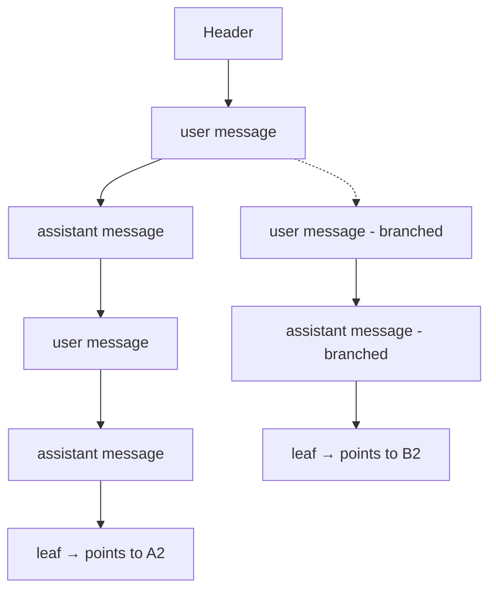

# Session Storage — Design Analysis

## Motivation

picocode currently has **zero persistent session storage**. The conversation history lives only in a `Vec<Message>` (`history` in `run_interactive`, `src/agent.rs:1108`) that is in-memory and lost on restart. There is no way to:

- Resume a previous session
- Name or label a session
- Fork/branch from an earlier point in the conversation
- Inspect past sessions

This document analyses how [pi agent](https://github.com/badlogic/pi-mono) (`~/src/pi/`) implements persistent session storage, and what it would take to build a similar system for picocode.

---

## pi's Session Storage Architecture

### Overview

pi stores sessions as **JSONL (JSON Lines) files**, one per session, in `~/.pi/agent/sessions/`. Each session file is an append-only log of structured entries representing every state change in the session.

### File Layout

```
~/.pi/agent/sessions/
  └── <cwd-encoded>/
       └── <timestamp>_<uuid>.jsonl
```

### File Format

Each file contains one JSON object per line:

**Line 1 — Session header:**
```json
{
  "type": "session",
  "version": 3,
  "id": "d703a1a9-1b7b-4fb1-b512-c9738b1fe617",
  "timestamp": "2025-11-20T23:33:50.805Z",
  "cwd": "/Users/badlogic/workspaces/pi-mono",
  "parentSession": "<optional parent path>",
  "metadata": { ... }
}
```

**Subsequent lines — Session entries (one per line):**

The session is a tree of entries, each with `id`, `parentId`, `type`, and `timestamp`:

| Entry Type | Fields | Purpose |
|---|---|---|
| `message` | `message: AgentMessage` | A user or assistant message (with full tool calls, results, usage) |
| `thinking_level_change` | `thinkingLevel: string` | Thinking mode change |
| `model_change` | `provider, modelId` | Model switch |
| `active_tools_change` | `activeToolNames` | Tool set change |
| `compaction` | `summary, firstKeptEntryId, tokensBefore` | Context compaction record |
| `branch_summary` | `fromId, summary` | Fork/branch annotation |
| `label` | `targetId, label` | Named label on an entry |
| `session_info` | `name` | Session name |
| `custom` / `custom_message` | `customType, data/content` | Extensible custom data |
| `leaf` | `targetId` | Current position pointer (used for "resume from here") |

The entries form a **tree** via `parentId` references. The current position is tracked by the latest `leaf` entry, which points to the active node in the tree. `getPathToRoot(leafId)` walks up `parentId` links to build the linear context sent to the LLM.

### Key Source Files (pi, TypeScript)

| File | Purpose |
|---|---|
| `packages/agent/src/harness/session/jsonl-storage.ts` | Low-level JSONL read/write: `SessionStorage` trait impl, parsing, validation |
| `packages/agent/src/harness/session/jsonl-repo.ts` | Repo abstraction: create, open, list, delete, fork sessions |
| `packages/agent/src/harness/session/session.ts` | `Session` class with `buildContext()` that walks tree to produce LLM context |
| `packages/agent/src/harness/session/repo-utils.ts` | Helpers: `getEntriesToFork`, session ID generation |
| `packages/agent/src/harness/types.ts` | All type definitions (`SessionTreeEntry`, `SessionStorage`, etc.) |
| `packages/coding-agent/src/session-manager.ts` | Higher-level session manager used by the UI |

### Entry Tree Model



> **Note:** Tool calls and their results are embedded within `Message` entries as content parts (matching rig's `Message` model). They are not separate tree nodes.

### Forking

When forking, pi:
1. Copies entries up to (but not including) the selected entry into a new session file
2. Sets `parentSession` in the new header to point to the source file
3. The new session is independent — it starts with the history up to the fork point

### Named Sessions

Session naming is done via a `session_info` entry:
```json
{ "type": "session_info", "name": "my-analysis", ... }
```

---

## What picocode Would Need

### 1. Data Model

picocode's current `history` is `Vec<rig_core::message::Message>` — a flat list. To support sessions, we need a **tree-structured entry model** similar to pi's `SessionTreeEntry`.

**Key types (Rust):**

```rust
#[derive(Serialize, Deserialize)]
struct SessionHeader {
    /// Always `"session"` — distinguishes the header from entry lines when
    /// re-parsing a JSONL file. Serialised as the JSON key `"type"`.
    #[serde(rename = "type")]
    kind: String,
    /// Schema version; currently `3`.
    version: u32,
    id: String,              // UUIDv7
    timestamp: String,       // ISO 8601
    cwd: String,
    /// Absolute path to the source session file when this session was forked.
    #[serde(skip_serializing_if = "Option::is_none")]
    parent_session: Option<std::path::PathBuf>,
    #[serde(skip_serializing_if = "Option::is_none")]
    metadata: Option<serde_json::Value>,
}

/// Shared metadata present on every entry.
#[derive(Serialize, Deserialize)]
struct SessionEntry {
    id: String,
    parent_id: Option<String>,
    timestamp: String,
    /// Type-specific payload. `#[serde(flatten)]` merges its fields (including
    /// the serde `"type"` tag) directly into the surrounding JSON object.
    #[serde(flatten)]
    content: SessionEntryContent,
}

/// The type-specific payload for a session entry.
///
/// `#[serde(tag = "type")]` writes a `"type"` key alongside the variant
/// fields, making the JSON self-describing and matching pi's wire format.
#[derive(Serialize, Deserialize)]
#[serde(tag = "type", rename_all = "snake_case")]
enum SessionEntryContent {
    Message {
        message: rig_core::message::Message,
    },
    ModelChange {
        provider: String,
        model_id: String,
    },
    ThinkingLevelChange {
        thinking_level: String,
    },
    ActiveToolsChange {
        active_tool_names: Vec<String>,
    },
    Compaction {
        summary: String,
        first_kept_entry_id: String,
        tokens_before: u64,
    },
    BranchSummary {
        from_id: String,
        summary: String,
    },
    Label {
        target_id: String,
        label: Option<String>,
    },
    SessionInfo {
        name: Option<String>,
    },
    Custom {
        custom_type: String,
        data: serde_json::Value,
    },
    CustomMessage {
        custom_type: String,
        content: serde_json::Value,
    },
    Leaf {
        /// Points to the active node in the entry tree; `None` clears the leaf.
        target_id: Option<String>,
    },
}
```

### 2. Storage Traits

The pi code has clean trait boundaries:

```rust
/// Low-level I/O for a single session file.
/// Requires `async_trait` for object-safe async dispatch.
#[async_trait]
trait SessionStorage {
    async fn get_metadata(&self) -> SessionMetadata;
    async fn get_leaf_id(&self) -> Option<String>;
    async fn set_leaf_id(&mut self, leaf_id: Option<String>);
    async fn create_entry_id(&self) -> String;
    async fn append_entry(&mut self, entry: SessionEntry);
    async fn get_entry(&self, id: &str) -> Option<SessionEntry>;
    /// Return all entries whose `"type"` tag matches `entry_type`.
    async fn find_entries(&self, entry_type: &str) -> Vec<SessionEntry>;
    /// Return the label string for the given entry id, if any.
    async fn get_label(&self, id: &str) -> Option<String>;
    async fn get_path_to_root(&self, leaf_id: &str) -> Vec<SessionEntry>;
    async fn get_entries(&self) -> Vec<SessionEntry>;
}

/// Repository managing multiple sessions in a directory.
#[async_trait]
trait SessionRepo {
    async fn create(&self, options: CreateOptions) -> Session;
    async fn open(&self, metadata: SessionMetadata) -> Session;
    async fn list(&self) -> Vec<SessionMetadata>;
    async fn delete(&self, metadata: SessionMetadata);
    async fn fork(&self, source: SessionMetadata, options: ForkOptions) -> Session;
}
```

### 3. Session Context Building

The `Session` class reconstructs the LLM context from the tree:

```rust
/// The reconstructed LLM context derived from a session branch.
struct SessionContext {
    /// Messages to pass as conversation history for the next LLM call.
    messages: Vec<rig_core::message::Message>,
    /// Thinking level in effect at the leaf (from the most recent
    /// `ThinkingLevelChange` on the path to root; `None` = use config default).
    thinking_level: Option<String>,
    /// Model in effect at the leaf (from the most recent `ModelChange`).
    model: Option<String>,
}

impl Session {
    /// Walk the tree from leaf to root, collect entries
    fn get_branch(&self) -> Vec<SessionEntry>;

    /// Apply transforms (e.g., compaction replaces old entries with summary)
    fn build_context(&self) -> SessionContext {
        let entries = self.get_branch();
        let transformed = self.apply_transforms(entries);
        SessionContext {
            messages: extract_messages(transformed),
            thinking_level: derive_thinking_level(transformed),
            model: derive_model(transformed),
        }
    }
}
```

`apply_transforms` is where context-level processing belongs — including `maybe_strip_reasoning`, which minimises the token payload sent to the LLM. Critically, stripping is **not** applied at storage time: session entries retain the full `Message` content, including reasoning blocks, so re-display of a past session shows the complete interleaved flow. This mirrors the existing scope of `maybe_strip_reasoning` in `agent.rs`, which already only affects the context sent to the service.

This is where pi's design is significantly more powerful than picocode's flat `Vec<Message>`: the context is *derived from the session tree* rather than being a separate mutable vector.

---

## Implementation Strategy

### Phase 1: Storage Layer (new `src/session/` module)

**What:**
- Define `SessionHeader`, `SessionEntry`, `SessionEntryContent` types (serde)
- Implement `SessionStorage` for a single JSONL file
- Implement `SessionRepo` for the directory of session files
- File layout: `~/.picocode/sessions/<cwd-encoded>/<timestamp>_<uuid>.jsonl`

**Dependencies:** `serde`, `serde_json`, `uuid` (for UUIDv7 or similar), `chrono`

**Estimated size:** ~600–800 lines (types + JSONL I/O + repo + error handling + unit tests)

### Phase 2: Session Object (`src/session/session.rs`)

**What:**
- `Session` struct wrapping a `SessionStorage`
- `get_branch()` — walk `parent_id` chain from leaf to root
- `build_context()` — produce `Vec<Message>` + thinking/model metadata
- `append_message()`, `append_model_change()`, etc.
- Session naming (`append_session_name()`)
- Forking via `SessionRepo::fork()`

**Estimated size:** ~350 lines

### Phase 3: Integrate into Agent Loop

**What:**
- Replace `history: Vec<Message>` in `run_interactive` with a `Session`
- On each turn, append user message and assistant message to session
- On `/model` or `/thinking`, append model/thinking change entries
- On context compaction (future), append compaction entry

**Key changes in `src/agent.rs`:**
- `PicoAgent::prompt()` signature grows an optional `&mut Session` parameter
- `persist_turn()` now writes to session storage instead of mutating a `Vec<Message>`
- `build_context()` on session replaces `history.clone()` for next turn

**Estimated size:** ~200 lines changed in `agent.rs`

### Phase 4: REPL Commands

**New slash commands — changes span three files:**
- `src/slash.rs` — add `SlashKind` variants (`Sessions`, `Session`, `Resume`, `Name`, `Fork`)
- `src/agent.rs` — dispatch the new variants in the main command loop
- `src/repl.rs` — TUI overlays for session listing and fork picker (reuses existing `Repl::select`)

**Commands:**
- `/sessions` — list past sessions
- `/session <name>` — show/resume a named session
- `/resume <id>` — resume a specific session
- `/name <name>` — name the current session
- `/fork` — interactive fork from earlier user message

**Estimated size:** ~200 lines

### Phase 5: Session Selector UI

A TUI overlay (similar to `/model` or `/settings`) to:
- List recent sessions with timestamps, names, model info
- Select a session to resume
- Preview session stats (token count, message count)

**Estimated size:** ~150 lines (reuses existing selector infrastructure)

---

## Key Design Decisions

### 1. JSONL vs SQLite vs Flat Files

**Decision: JSONL** (same as pi, preserves pi session import compatibility)

Pros:
- Human-readable, greppable, pipeable (`cat session.jsonl | jq`)
- Append-only — no locking needed for single-writer
- Easy to debug and inspect
- No schema migrations (each line is self-describing)
- Git-friendly (diffs are line-based)
- Wire-compatible with pi's on-disk format, enabling a future `/import-pi-session` (see Open Question 3)

Cons:
- O(n) reads: full file scan on every open to rebuild the in-memory index
- No random access without building an index
- Large files for long sessions

Mitigation:
- Compaction (already planned in `doc/compaction.md`) replaces old detail with summaries, keeping sessions compact
- An in-memory index (`HashMap<String, SessionEntry>`) is built on open; `build_context()` only materialises the path-to-root branch, so memory is dominated by the active conversation rather than the full tree. The full index is needed only for tree operations (fork picker, label lookup) and could be lazy-loaded as a future optimisation.
- Session files are small in practice (< 1MB for typical agent sessions). picocode relies on terminal scrollback for display, so the in-memory index has no second consumer beyond tree operations.

#### Startup performance

The O(n) cost of JSONL manifests differently by operation:

| Case | What happens | Typical latency |
|---|---|---|
| **New session** | File created lazily on first `append_entry`; no upfront I/O | Instant |
| **Resume** | Full file scan → parse all JSON lines → build `HashMap` → find leaf → walk path to root | < 5 ms for a typical (< 1 MB) session |
| **Fork picker** | Same full scan; needed to enumerate all user messages for the picker UI | < 5 ms typical |
| **Fork create** | Write entries up to the fork point into a new JSONL file | Proportional to fork depth |

For sessions bounded by the LLM context window these numbers are not user-visible. They become relevant only if a session grows large before compaction fires or if the fork picker must enumerate a very long history.

#### Alternatives if pi compatibility is dropped

If the `/import-pi-session` goal is abandoned, three alternatives are worth considering:

**A. JSONL picocode-native (zero friction)**

Keep JSONL but drop all camelCase compatibility shims. rig's `Message` type is stored directly via its own `Serialize`/`Deserialize` impls (snake_case tagged enum). This is effectively what picocode already writes — the compatibility concern was only about *reading* pi's files, not about picocode's own output. No structural change to the current design; just remove the import-compatibility documentation and serde aliases.

**B. SQLite**

One `.db` file per CWD session directory (WAL mode, no explicit locking). Schema: a single `entries` table with `id TEXT PRIMARY KEY`, `parent_id TEXT`, `timestamp TEXT`, `type TEXT`, and `payload TEXT` (JSON blob). Path-to-root via a recursive CTE:

```sql
WITH RECURSIVE path AS (
  SELECT * FROM entries WHERE id = ?leaf_id
  UNION ALL
  SELECT e.* FROM entries e JOIN path p ON e.id = p.parent_id
)
SELECT * FROM path;
```

| Case | SQLite behaviour | Notes |
|---|---|---|
| **New session** | `sqlite3_open` + `CREATE TABLE IF NOT EXISTS` on a new file | ~ 1–3 ms first open; negligible thereafter |
| **Resume** | O(k) recursive CTE; only path-to-root entries are loaded | Fast regardless of total session size |
| **Fork picker** | `SELECT … WHERE type = 'message' AND JSON_EXTRACT(payload, '$.role') = 'user'` | O(user messages), no full scan |
| **Fork create** | Targeted `INSERT … SELECT` for entries up to fork point | O(fork depth) |

Trade-off: loses human-readability (`sqlite3 <file> .dump` works but is not `jq`). New dependency: `rusqlite` (mature, widely used in the Rust ecosystem).

**C. JSONL + compact sidecar**

Keep the full JSONL for human inspection, and add a tiny `<session-id>.meta` companion file that caches the fast-path data:

```json
{
  "leaf_id": "...",
  "name": "optional session name",
  "path": [
    { "id": "abc", "byte_offset": 312, "byte_len": 180 },
    ...
  ],
  "user_message_previews": [
    { "id": "abc", "preview": "first 80 chars of user text…" },
    ...
  ],
  "token_count": 12345
}
```

| Case | Sidecar behaviour |
|---|---|
| **New session** | Write empty `.meta` on session create; update after each turn |
| **Resume** | Read `.meta` (tiny) → seek to byte offsets → read only path entries from JSONL |
| **Fork picker** | User-message previews already in `.meta`; no JSONL scan needed |
| **Fork create** | Write path entries to new JSONL + generate new `.meta` |

Trade-off: `.meta` must stay in sync with the JSONL; if a crash leaves them diverged, `.meta` must be rebuildable via a full JSONL scan (fallback). Moderate complexity, but gives fast resume and fork startup while keeping the JSONL human-readable.

**D. Split-header binary + mmap**

This is the practical form of a "zerocopy flat file." Each entry is written as a fixed-size binary header followed by a length-prefixed payload:

```
[ entry_len: u32 | type: u8 | id: [u8;16] | parent_id: [u8;16] | timestamp_ms: i64 ]
[ payload_len: u32 | payload bytes (serde_json or bincode) ]
```

The header is 45 bytes, fixed and `#[repr(C)]`. The file is memory-mapped via `memmap2`. Index building scans *only* the 45-byte headers, jumping over payload bytes via `entry_len`, without deserialising any payload. Payload bytes for a specific entry are read on demand by seeking to `header_offset + header_size`.

| Case | Behaviour |
|---|---|
| **New session** | `File::create` + write binary session header + `mmap`. Instant. |
| **Resume** | mmap (instant, no I/O until page faults); scan 45-byte headers to build `id → offset` index; deserialise only path-to-root payloads |
| **Fork picker** | Scan headers for `type == Message`; read only those payloads |
| **Fork create** | Copy header+payload byte ranges for path entries into new file |

**Where the gains are real:** index building is scanning N × 45 bytes of sequential binary rather than parsing N JSON objects. For 500 entries that is ~22 KB of sequential reads vs ~100–250 KB of JSON parse — roughly 10× faster index construction. mmap's lazy-load property means even a large session file costs nothing to "open"; only the pages containing accessed entries are faulted in.

**The ceiling on "zerocopy":** true zero-copy deserialization (e.g., `rkyv`) requires every type in the graph to derive `rkyv::Archive`. rig's `Message` only derives serde `Serialize`/`Deserialize` — it has no `Archive` impl, and its content types (`OneOrMany<UserContent>`, heap-allocated `String`, `Vec`, `serde_json::Value`) cannot be zerocopy in any meaningful sense regardless of the outer format. The payload bytes will always require a deserialization step. The zerocopy win here is therefore limited to **header-only index scans** — the payload still pays full serde cost on each access, which is the same as any other option.

**Honest trade-off:** for typical picocode sessions (< 1 MB, bounded by compaction) the JSONL scan is already < 5 ms; the 10× improvement brings it to < 0.5 ms, which is not user-visible. The format is worthwhile only if sessions can grow very large before compaction fires, or if startup latency budget is extremely tight. Costs: loses human-readability entirely, requires a custom binary reader/writer (~150–200 lines), and `memmap2` as a new dependency (small, safe, widely used).

#### Format comparison summary

| | JSONL (pi-compat) | SQLite | JSONL + sidecar | Split-header binary |
|---|---|---|---|---|
| **New session** | Instant | ~ 1–3 ms | Instant | Instant |
| **Resume** | O(n) JSON parse | O(k) CTE query | O(k) sidecar seeks | O(n) header scan + O(k) payload reads |
| **Fork picker** | O(n) JSON parse | O(user msgs) SQL | O(user msgs) from `.meta` | O(n) header scan |
| **Fork create** | O(n) write | O(fork depth) INSERT | O(fork depth) write | O(fork depth) byte copy |
| **Human-readable** | ✓ | via `.dump` | ✓ (JSONL part) | ✗ |
| **pi import path** | ✓ | ✗ | ✗ | ✗ |
| **New dependencies** | none | `rusqlite` | none | `memmap2` |
| **Implementation complexity** | low | medium | medium | medium |

### 2. Entry Tree vs Flat Message List

**Decision: Tree** (same as pi)

The tree model enables:
- Forking from any point (not just the latest)
- Multiple branches from the same parent
- Labels on historical entries
- Compaction that replaces subtrees while preserving the branching structure

A flat list cannot express these without ad-hoc hacks.

### 3. Leaf Pointers

The `leaf` entry is a pointer to the current position in the tree. When you fork and jump to an earlier point, the leaf is updated to point to the fork target. This is simpler than maintaining a separate cursor.

### 4. UUIDv7 for Entry IDs

UUIDv7 is time-sortable (first bytes are timestamp). This means:
- Entries are roughly chronological when sorted by ID
- No separate `created_at` index needed for many queries
- No collisions (unlike sequential IDs)

Rust crate: `uuid` with the `v7` feature (available in uuid 1.x+). Note that v7 generation requires a `uuid::timestamp::context::Context` (a monotonic counter that guards against clock rewinds); create one at agent startup and reuse it for the session lifetime.

Pi takes a different approach for entry IDs: `uuidv7().slice(-8)` — the last 8 characters of a freshly generated UUIDv7 string, collision-checked against IDs already in the session (`byId` map), falling back to the full UUID after 100 failed attempts. The rationale (from the pi source): the UUIDv7 timestamp prefix is nearly constant between close calls, so all usable entropy is in the random tail. Picocode can use full UUIDv7s — they are longer but unambiguous and require no collision check. The importer just needs to accept any string ID.

### 5. Compaction Integration

The existing compaction design (`doc/compaction.md`) already plans for compaction entries. In pi, compaction produces a `CompactionEntry` that:
- Replaces a range of old entries with a summary message
- Sets `firstKeptEntryId` so the context builder skips compressed history
- Preserves the tree structure (the compaction entry has `parentId` linking it into the tree)

picocode's future `compact()` should do the same.

---

## Required Rust Dependencies

Add to `Cargo.toml`:

```toml
uuid = { version = "1.0", features = ["v7", "serde"] }
chrono = "0.4"
```

(Existing: `serde`, `serde_json`, `tokio`)

---

## File Structure

```
src/
  session/
    mod.rs          # Re-exports
    types.rs        # SessionHeader, SessionEntry, SessionEntryContent, SessionMetadata, etc.
    storage.rs      # JsonlSessionStorage (single file)
    repo.rs         # JsonlSessionRepo (directory of sessions)
    session.rs      # Session struct with context building, append helpers
  agent.rs          # Modified: uses Session instead of Vec<Message>; dispatches new slash variants
  repl.rs           # Modified: session selector and fork picker TUI overlays
  slash.rs          # Modified: new SlashKind variants (Sessions, Session, Resume, Name, Fork)
```

---

## Migration Path

### Step 1: Add types + storage (no behavior change)
- Implement `SessionHeader`, `SessionEntry`, `SessionStorage`, `SessionRepo`
- Unit tests for round-trip serialization, tree walking, fork, listing
- No changes to `agent.rs` yet

### Step 2: Add Session wrapper
- Implement `Session` with context building from tree
- Unit tests: produce a session tree, verify `build_context()` yields correct messages

### Step 3: Wire into agent loop
- Replace `history: Vec<Message>` with `session: Session`
- On every turn: `session.append_message(user_msg)`, `session.append_message(assistant_msg)`
- On `/model`: `session.append_model_change()`
- On `/thinking`: `session.append_thinking_level_change()`
- Refactor `persist_turn()` to write to session storage instead of mutating `Vec<Message>`. Both completed and cancelled turns become plain `append_entry` calls — rig's `PromptCancelled` error already carries the full in-flight history (including any partial assistant content), so no special `cancelled` entry variant is needed. `build_context()` treats partial assistant messages as valid context entries.
- Store the **pre-strip** form: messages are written to session storage before `maybe_strip_reasoning` is applied. Stripping remains scoped to `build_context()` (context sent to the LLM), leaving the stored session intact for re-display.

### Step 4: Add REPL commands
- `/sessions` — list
- `/session <name>` — resume
- `/resume <id>` — resume by ID
- `/name <name>` — name current
- `/fork` — show user message picker, fork from selected

### Step 5: Cleanup
- Remove the old `history: Vec<Message>` entirely
- Move `persist_turn()` into the session layer (`Session::append_turn`)
- Keep `maybe_strip_reasoning()` in `agent.rs` — it handles provider-specific reasoning-token stripping that is orthogonal to session persistence and remains necessary regardless of storage backend

---

## Open Questions

1. **Compaction interaction:** When compaction runs and replaces old entries with a summary, the session tree still references those old entries via `parentId`. The compaction entry's `firstKeptEntryId` tells the context builder where to start reading. This needs careful design.

2. **Concurrent sessions:** If two picocode instances run in the same directory, each writes to its own uniquely-named JSONL file (guaranteed by the UUID in the filename), so there is no concurrent-write problem for individual sessions. The only shared resource is the session *directory*; directory listing is atomic at the OS level. No locking required.

3. **Backwards compatibility / pi import:** Confirmed from an actual pi session file. Two obstacles, very different in difficulty.

   **camelCase vs snake_case — trivial.** Pi uses camelCase throughout: `parentId`, `modelId`, `thinkingLevel`, `toolCallId`, `toolName`, `isError`, `stopReason`, `responseId`, `cacheRead`, `cacheWrite`, `totalTokens`, `cacheWrite1h`. Add `#[serde(rename_all = "camelCase")]` on a pi-import-only mirror struct. About 30–50 lines.

   **`AgentMessage` schema — easy to moderate.** Pi does NOT use the raw Anthropic API format. It uses its own abstracted format with three roles (`"user"`, `"assistant"`, `"toolResult"`) and typed content items. Confirmed content types: `"text"`, `"thinking"`, `"toolCall"`. Concrete wire shapes:

   ```jsonc
   // user message
   { "role": "user", "content": [{"type":"text","text":"..."}], "timestamp": 1234567890 }

   // assistant message
   { "role": "assistant",
     "content": [
       {"type":"thinking",  "thinking":"...", "thinkingSignature":"..."},
       {"type":"toolCall",  "id":"toolu_...",  "name":"bash",  "arguments":{...}},
       {"type":"text",      "text":"..."}       // when present
     ],
     "api":"anthropic-messages", "provider":"anthropic", "model":"...",
     "usage":{"input":0,"output":0,"cacheRead":0,"cacheWrite":0,
              "totalTokens":0,"cost":{...},"cacheWrite1h":0,"reasoning":0},
     "stopReason":"...", "responseId":"msg_...", "timestamp": 1234567890 }

   // tool result (separate message per result, not batched)
   { "role": "toolResult", "toolCallId":"toolu_...", "toolName":"bash",
     "content": [{"type":"text","text":"..."}], "isError": false, "timestamp": 1234567890 }
   ```

   Mapping to rig:

   | Pi content | rig equivalent | Difficulty |
   |---|---|---|
   | `role:"user"`, `type:"text"` | `Message::User` → `UserContent::Text` | Trivial |
   | `role:"assistant"`, `type:"text"` | `Message::Assistant` → `AssistantContent::Text` | Trivial |
   | `type:"thinking"`, fields `thinking`/`thinkingSignature` | `AssistantContent::Reasoning(Reasoning { content: [ReasoningContent::Text { text, signature }] })` | Easy: rename two fields |
   | `type:"toolCall"`, fields `id`/`name`/`arguments` | `AssistantContent::ToolCall(ToolCall { id, function: ToolFunction { name, arguments } })` | Easy: wrap `name`+`arguments` into `ToolFunction` |
   | `role:"toolResult"` messages | `Message::User` → `UserContent::ToolResult(ToolResult { id: toolCallId, … })` | Moderate: pi stores one `"toolResult"` entry per tool call. In rig's **message history** (the `Vec<Message>` passed to the next LLM call and returned by `resp.messages()`), all results for a turn are committed together as a single `Message::User` with multiple `UserContent::ToolResult` items — `run.tool_results(committed)` in `prompt_request/streaming.rs` does this before surfacing individual `ToolResultEvent`s to the streaming consumer. Note that at the streaming/UI level results still arrive one at a time; it is only at the history level that they are batched. Importer must scan ahead to group consecutive pi `"toolResult"` entries into one `User` message. |

   **Entry IDs:** Pi uses 8-character hex strings for entry IDs (e.g. `"84c3124c"`); the session header uses a standard UUID. Picocode's plan uses UUIDv7 throughout. The importer just needs to accept any string, not validate as UUID.

   **Usage data:** Pi stores rich per-turn usage on every assistant message (`input`, `output`, `cacheRead`, `cacheWrite`, `totalTokens`, `cost`, `reasoning` tokens). Picocode could surface this in a future `/stat` overlay by reading it back from session entries rather than tracking it separately at runtime.

   **Revised estimate:** ~100–150 lines of conversion code. The format is clean and the mapping is concrete. A `/import-pi-session <path>` command is the natural implementation vehicle. Out of scope for the initial implementation, but feasible.

4. **Error recovery:** If the JSONL file is truncated (crash during write), the last line may be partial. On open, skip the last line if it doesn't parse as valid JSON.

---

## Reference: pi's Types (for translation)

These are the canonical TypeScript types that the Rust types above are modeled after:

```typescript
// Session header
interface SessionHeader {
  type: "session";
  version: 3;
  id: string;
  timestamp: string;
  cwd: string;
  parentSession?: string;
  metadata?: Record<string, unknown>;
}

// Session entry base
interface SessionTreeEntryBase {
  type: string;
  id: string;
  parentId: string | null;
  timestamp: string;
}

// Entry variants
type SessionTreeEntry =
  | MessageEntry        // type: "message", message: AgentMessage
  | ThinkingLevelChangeEntry
  | ModelChangeEntry
  | ActiveToolsChangeEntry
  | CompactionEntry
  | BranchSummaryEntry
  | CustomEntry
  | CustomMessageEntry
  | LabelEntry
  | SessionInfoEntry     // type: "session_info", name?: string
  | LeafEntry;           // type: "leaf", targetId: string | null

// Storage trait
interface SessionStorage<TMetadata> {
  getMetadata(): Promise<TMetadata>;
  getLeafId(): Promise<string | null>;
  setLeafId(leafId: string | null): Promise<void>;
  createEntryId(): Promise<string>;
  appendEntry(entry: SessionTreeEntry): Promise<void>;
  getEntry(id: string): Promise<SessionTreeEntry | undefined>;
  findEntries<T>(type: T): Promise<Extract<SessionTreeEntry, {type: T}>[]>;
  getLabel(id: string): Promise<string | undefined>;
  getPathToRoot(leafId: string | null): Promise<SessionTreeEntry[]>;
  getEntries(): Promise<SessionTreeEntry[]>;
}

// Repo trait
interface SessionRepo<TMetadata, TCreateOptions, TListOptions> {
  create(options: TCreateOptions): Promise<Session<TMetadata>>;
  open(metadata: TMetadata): Promise<Session<TMetadata>>;
  list(options?: TListOptions): Promise<TMetadata[]>;
  delete(metadata: TMetadata): Promise<void>;
  fork(source: TMetadata, options: SessionForkOptions & TCreateOptions): Promise<Session<TMetadata>>;
}
```
